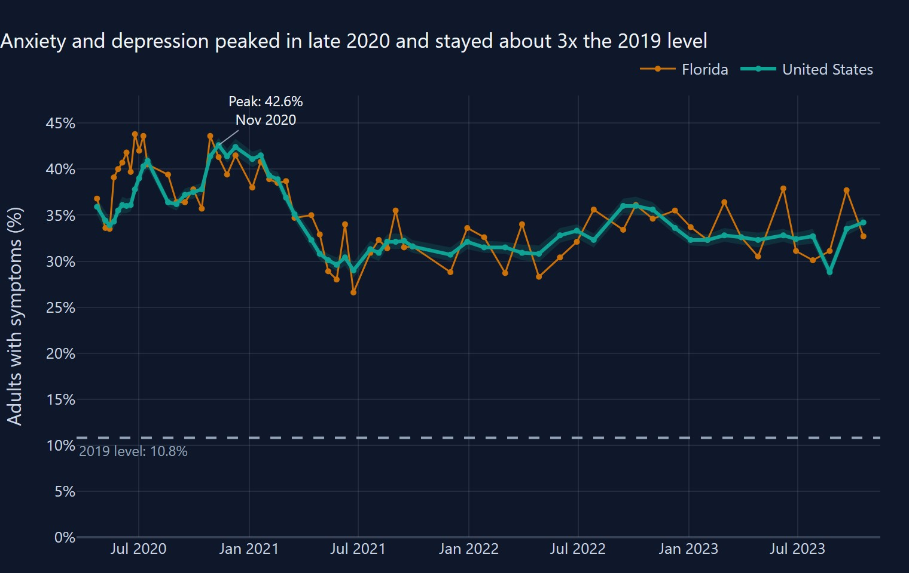
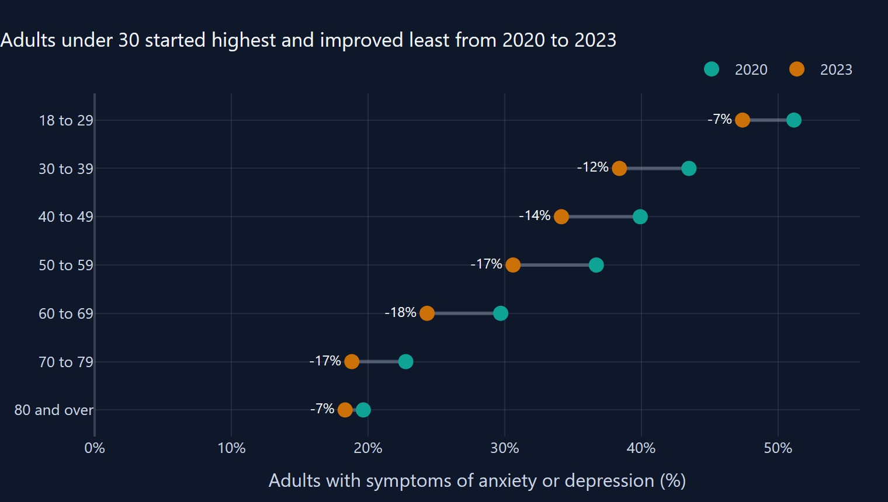
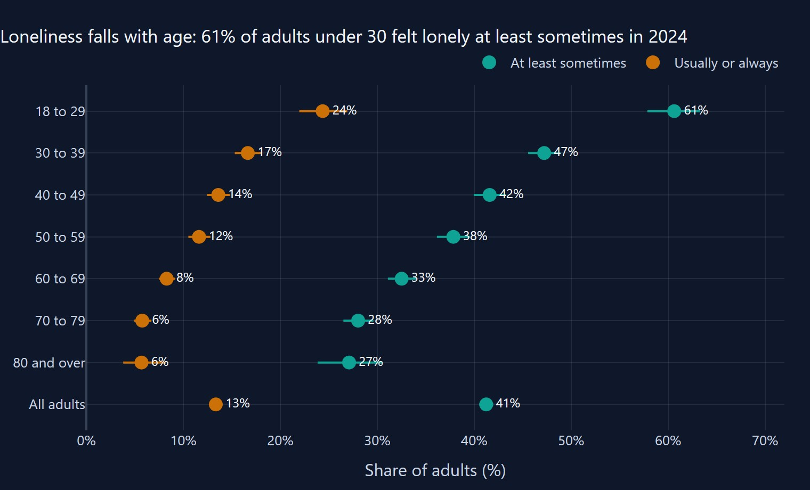
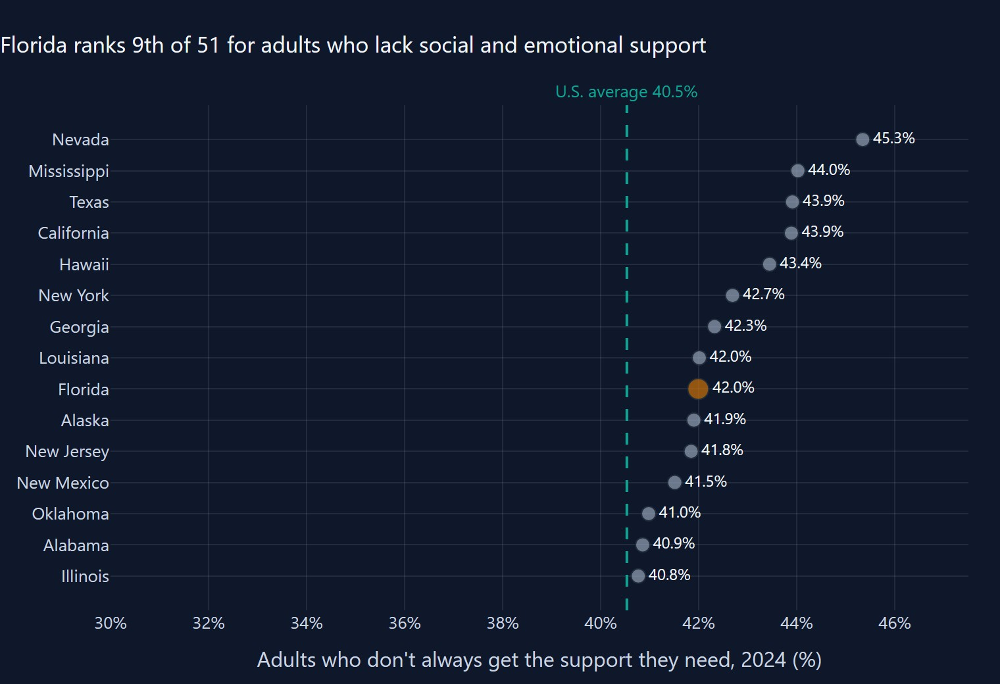

import palms from "./photo-palms.jpg";
import act1 from "./act-1.jpg";
import act2 from "./act-2.jpg";
import act3 from "./act-3.jpg";
import act4 from "./act-4.jpg";
import act5 from "./act-5.jpg";

export const hl = { background: "linear-gradient(90deg, #c8102e, #e23744)", color: "#ffffff", padding: ".15em .5em", borderRadius: "4px", fontWeight: 700, borderBottom: "3px solid #1d8a4a" };
export const hlInline = { ...hl, padding: ".1em .35em", boxDecorationBreak: "clone", WebkitBoxDecorationBreak: "clone" };
export const tiles = { display: "grid", gridTemplateColumns: "repeat(auto-fit, minmax(150px, 1fr))", gap: "0.75rem", margin: "1.5rem 0", alignItems: "stretch" };
export const tile = { border: "1px solid rgba(148,163,184,0.25)", borderTop: "3px solid #c8102e", borderRadius: "8px", padding: "0.9rem 1rem", background: "rgba(15,23,42,0.6)", display: "flex", flexDirection: "column", justifyContent: "flex-start", margin: 0 };
export const big = { display: "block", fontSize: "2rem", fontWeight: 800, lineHeight: 1.1, color: "#f1f5f9" };
export const helps = { borderLeft: "4px solid #1d8a4a", background: "rgba(29,138,74,0.12)", borderRadius: "0 8px 8px 0", padding: "0.8rem 1rem", margin: "1.25rem 0 2rem" };
export const small = { display: "block", fontSize: "0.85rem", lineHeight: 1.35, marginTop: "0.35rem", color: "#94a3b8" };

## Introduction

This holiday season, I feel more isolated than sad. Today is November 18, 2026. Thanksgiving is eight days away, and I will spend it alone here in Florida.

One thing helps. When I say <mark style={hlInline}>"happy holidays"</mark> to someone, a cashier, a coworker, a neighbor, it lifts me, and most of the time I can see it lift them.

I wanted to know how much of today's isolation is left over from the pandemic, and whether small moments like "happy holidays" can reach it. This article reports five findings from federal survey data. After each one comes a small act of cheer that reaches the people in it, and Section 6 brings the five together.

  
42.6%of adults had anxiety or depression at the Nov. 2020 peak

  
3×the 2019 level, still, at the end of 2023

  
61%of adults under 30 felt lonely at least sometimes in 2024

  
#9Florida's rank of 51 in 2024 for adults who lacked social and emotional support

**The five findings:**

1. Anxiety and depression never returned to pre-pandemic levels.
2. Adults under 30 started highest and recovered least.
3. In 2024, 4 in 10 adults felt lonely, and 6 in 10 under 30.
4. In 2024, Florida ranked 9th of 51 for adults who lacked support.
5. Where chronic loneliness is higher, so are anxiety and depression.

## 1. Anxiety and Depression Never Returned to Pre-Pandemic Levels

*Share of adults with symptoms of anxiety or depressive disorder in the past week, April 2020 to October 2023. Teal band: the U.S. margin of error.*

- **Before:** 10.8% of adults had symptoms in 2019.
- **Peak:** 42.6% in November 2020, the first pandemic holiday season.
- **Three years later:** about 32% through 2023, still roughly **three times** the 2019 level.
- **Florida** tracked the country almost exactly.

🎄 <strong>What helps:</strong> In 2020, the holidays were spent apart. This year, saying "happy holidays" in person, and meaning it, closes a little of that distance for both people.

## 2. Adults Under 30 Started Highest and Recovered Least

*Share of adults with symptoms of anxiety or depression, 2020 average against 2023 average, with the percent change.*

- Half of adults under 30 had symptoms in 2020. By 2023 that had fallen only **7%**, to 47%.
- Adults 50 to 79 improved by **17% to 18%**.
- The pandemic hit young adults while most people build an adult social life: college, first jobs, first apartments, new cities. That loss was still visible three years later.

🎄 <strong>What helps:</strong> The cashier, barista, or new coworker under 30 is the person most likely still carrying this. Use their name and ask how their day is going.

## 3. In 2024, 4 in 10 Adults Felt Lonely, and 6 in 10 Under 30

*Share of adults who felt lonely, by age, January to September 2024. Lines show 95% confidence intervals.*

- **41%** of U.S. adults felt lonely at least sometimes, and **13%** usually or always.
- Adults 18 to 29: **61%** at least sometimes and **24%** usually or always, four times the rate of adults over 70.
- Americans spent **333 minutes a day alone** by 2020, up from 285 in 2003, and 20 minutes with friends, down from 60.
- In 2025, only **30%** of Americans socialized on an average day, down from 38% in 2015. **29%** of households are one person living alone.
- In April 2026, **42%** of adults said they feel lonely at least weekly, up from 33% a year earlier. The trend is getting worse, not better.

🎄 <strong>What helps:</strong> With 4 in 10 adults lonely, someone you pass today is likely one of them. A smile and eye contact tell them they were seen.

## 4. In 2024, Florida Ranked 9th of 51 for Adults Who Lacked Support

<Figure
  src={palms}
  alt="Palm trunks wrapped in multicolored holiday lights at dusk, with a sunset over the water behind them"
  caption="Christmas palms at the Edison and Ford Winter Estates in Fort Myers."
  author="Russ"
  sourceUrl="https://commons.wikimedia.org/wiki/File:Christmas_palms_edison_and_ford_estates_(16128689981).jpg"
  license="CC BY 2.0"
  licenseUrl="https://creativecommons.org/licenses/by/2.0/"
  layout="wide"
/>

Loneliness measures how people feel. Support measures whether anyone is there when they need it.

*Share of adults who sometimes, rarely, or never get the social and emotional support they need, 2024. The 15 highest of the 50 states and Washington, D.C.*

- In 2024, Floridians felt lonely about as often as other Americans: **40%** at least sometimes, against 41% nationally.
- But **42%** didn't always get the support they need, **9th-highest** of the 50 states and D.C., above the U.S. average of 40.5%.
- The margins between states are small, so the exact rank is approximate, but Florida sits in the upper third.
- For the many Floridians who moved here from somewhere else, the family and old friends who would fill that gap often live hundreds of miles away.

🎄 <strong>What helps:</strong> Offer help before it is asked for. Check on a neighbor who moved here recently, or set one more place at your table.

## 5. Where Chronic Loneliness Is Higher, So Are Anxiety and Depression

*Each dot is a state, 2024. Dashed line: best fit.*

- The two rise together almost one for one: each additional point of chronic loneliness goes with about **1.25 points** more anxiety or depression.
- Chronic loneliness alone accounts for **86%** of the difference in anxiety and depression between states.
- How often people see friends or family showed almost **no link** to loneliness. Feeling supported counts more than a full calendar.
- This compares states, not individuals, so it shows the two travel together rather than proving one causes the other. In 2023 the U.S. Surgeon General warned that lacking social connection raises the risk of early death about as much as smoking up to 15 cigarettes a day.

🎄 <strong>What helps:</strong> Support beat frequency. One real conversation, or an hour serving alongside others, does more than many passing hellos.

## 6. Five Small Acts Reach the People in These Numbers

The evidence is clear: <mark style={hlInline}>people need cheer this season</mark>. In the latest federal surveys, anxiety and depression were still three times their 2019 level in 2023, 4 in 10 adults felt lonely in 2024, and more than 4 in 10 Floridians lacked someone to lean on. And it is not easing: in April 2026, 42% of adults said they feel lonely every week, up from 33% a year earlier. <mark style={hlInline}>The good news is that cheer is something anyone can give.</mark> Each act below is backed by research, and each one lifts the person giving it as much as the person receiving it. The first four cost nothing and take less than a minute.

### 1. Say "happy holidays," and mean it

<Figure
  src={act1}
  alt="Two mugs of hot cocoa beside graham crackers and a bowl of melted chocolate"
  caption="Hot cocoa, the gift in the Chicago study."
  author="Personal Creations"
  sourceUrl="https://commons.wikimedia.org/wiki/File:Chocolate_sauce_in_a_bowl_next_to_crushed_graham_crackers_and_two_mugs_of_hot_cocoa_(15877974025).jpg"
  license="CC BY 2.0"
  licenseUrl="https://creativecommons.org/licenses/by/2.0/"
  layout="inset"
/>

**The study:** At an outdoor ice rink in Chicago, psychologists gave people a cup of hot chocolate and asked them to hand it to a stranger. Before handing it over, each giver guessed how good the stranger would feel, on a scale from −5 (much worse than usual) to +5 (much better than usual).

**What it found:** Givers guessed **+2.7**. Strangers reported **+3.5**. People consistently underestimate how much a small, warm gesture lifts someone, because they focus on how small it is, while the person receiving it focuses on the warmth.

**Try it:** Say it to the person, not past them, with a moment of eye contact. It reaches the **41%** of adults who felt lonely in 2024, without knowing which ones they are.

### 2. Smile and make eye contact

<Figure
  src={act2}
  alt="A white sign on a brick wall that reads: Please Smile at strangers"
  caption="A sign in Hattiesburg, Mississippi."
  author="Paul Lowry"
  sourceUrl="https://commons.wikimedia.org/wiki/File:Please_Smile_at_Strangers_-_sign_in_Hattisburg,_MS.jpg"
  license="CC BY 2.0"
  licenseUrl="https://creativecommons.org/licenses/by/2.0/"
  layout="inset-left"
/>

**The study:** At Purdue University, a researcher walked past strangers on campus and did one of three things: made eye contact, made eye contact and smiled, or looked right through them as if they weren't there. A second researcher then stopped each person and asked how connected to others they felt.

**What it found:** People who were looked through felt **more disconnected** than people who got eye contact, with or without a smile. A passing glance from a stranger was enough to change how included people felt.

**Try it:** Look up from the phone in line, at the pump, and in the parking lot. It reaches the **13%** of adults who felt lonely usually or always in 2024.

### 3. Offer help

<Figure
  src={act3}
  alt="A cashier in a holiday hat at a store counter the day before Christmas"
  caption="A cashier on the day before Christmas."
  author="W.carter"
  sourceUrl="https://commons.wikimedia.org/wiki/File:Gerd_at_the_cashier_counter_in_ICA_Brastad_the_day_before_Christmas.jpg"
  license="CC BY-SA 4.0"
  licenseUrl="https://creativecommons.org/licenses/by-sa/4.0/"
  layout="inset"
/>

**The study:** In six experiments with more than 2,000 people, researchers had some people ask for help and others give it, then compared what each side expected with what actually happened.

**What it found:** People who needed help guessed others would be **less willing** to help, and would feel more put out by it, than the helpers actually were. Helpers also felt better afterward than the people asking expected. Fear of being a burden keeps people from asking.

**Try it:** Offer before anyone asks. Help a neighbor string lights on the palms, give a coworker a hand with a deadline, or offer a ride to someone who can't drive. It reaches the **42%** of Floridians who, in 2024, didn't always get the support they need.

### 4. Acknowledge the human

<Figure
  src={act4}
  alt="A smiling barista sets a drink on a coffee shop counter"
  caption="A barista at a coffee shop counter."
  author="Joshua Noble"
  sourceUrl="https://commons.wikimedia.org/wiki/File:Beale_Street_Brews_Counter_(26499287821).jpg"
  license="CC BY-SA 2.0"
  licenseUrl="https://creativecommons.org/licenses/by-sa/2.0/"
  layout="inset-left"
/>

**The study:** Researchers sent customers into a busy coffee shop with one of two instructions. One group was told to be as efficient as possible: order, pay, leave. The other was told to smile, make eye contact, and have a brief, genuine conversation with the barista.

**What it found:** The customers who connected left in a **better mood** and with a **stronger sense of belonging** than the customers who rushed.

**Try it:** Use a name when there's a name tag. Ask how someone's day is going, and wait for the answer. It reaches adults under 30, **61%** of whom felt lonely in 2024 and who are often the person behind the counter.

### 5. Give back to your community

<Figure
  src={act5}
  alt="Volunteers in aprons serve a holiday meal from behind a buffet line decorated with greenery"
  caption="Volunteers serve a holiday meal."
  author="U.S. Air Force photo by Senior Airman Rome Bowermaster"
  sourceUrl="https://commons.wikimedia.org/wiki/File:Team_Osan_leaders_join_Airmen_for_holiday_meal_(9415126).jpg"
  license="Public domain"
  licenseUrl="https://commons.wikimedia.org/wiki/File:Team_Osan_leaders_join_Airmen_for_holiday_meal_(9415126).jpg"
  layout="inset"
/>

**The study:** Researchers followed **5,882** Americans over 50 for several years, comparing those who lost a spouse with those who stayed married, and tracking who volunteered.

**What it found:** Losing a spouse raised loneliness, as expected. But widowed people who began volunteering **two or more hours a week** ended up about as lonely as married people who volunteered as much. Regular service largely offset the loneliness of the loss.

**Try it:** Serve a holiday meal, sort cans at a food bank, or wrap gifts for a toy drive. It reaches the people in the **29%** of U.S. households where one person lives alone, and it reaches the volunteer too.

## Conclusion: If You Feel Like You Are in Need, Give

This article reported what the pandemic left behind, and the small act that answers each finding:

1. **Anxiety and depression never returned to 2019 levels.** They peaked at 42.6% in November 2020 and were still three times the 2019 level at the end of 2023. <mark style={hlInline}>Answer: say "happy holidays" in person, and mean it.</mark>
2. **Young adults carry the longest aftereffects.** Adults under 30 recovered least, and 61% felt lonely at least sometimes in 2024. <mark style={hlInline}>Answer: acknowledge the human behind the counter.</mark>
3. **Loneliness is widespread and rising.** 41% of adults felt lonely in 2024, and weekly loneliness rose from 33% to 42% between 2025 and 2026. <mark style={hlInline}>Answer: smile, and let people know they were seen.</mark>
4. **Florida's gap is support.** In 2024, 42% of Floridians didn't always get the support they need, 9th-highest in the country. <mark style={hlInline}>Answer: offer help before it is asked for.</mark>
5. **Loneliness and mental health move together.** States with more chronic loneliness have more anxiety and depression. <mark style={hlInline}>Answer: give real time, to a person or to your community.</mark>

Each of these lifts the person who receives it, and the person who gives it, more than either expects.

I recently heard the saying "don't pour from an empty cup." I don't believe the cup is ever empty. Giving is one of the few things that refills it while you pour. The research in this article shows it: helpers felt better than the people they helped expected, and widowed adults who volunteered ended up about as lonely as married ones. Rest still counts, and so does asking for help when you need it. But a kind word, a smile, or an hour of service doesn't drain the cup. When I feel most alone is exactly when giving helps most.

So, to you, reading this: <mark style={hlInline}>happy holidays</mark>. I mean it.

Data: CDC Household Pulse Survey, 2020 to 2024 (2019 benchmark from the National Health Interview Survey); U.S. Bureau of Labor Statistics; U.S. Census Bureau; American Psychiatric Association; U.S. Surgeon General. Research: Kumar & Epley (2022), Wesselmann et al. (2012), Zhao & Epley (2022), Sandstrom & Dunn (2014), Carr et al. (2018).

